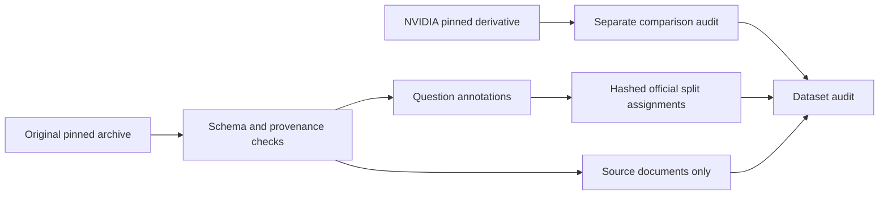

# Model Adaptation Lab

**When are prompting and retrieval sufficient for technical support QA, and when is LoRA worth its cost?**

This research framework will compare Qwen2.5-1.5B-Instruct across zero-shot, few-shot,
RAG, LoRA, and LoRA + RAG under a shared evaluation protocol. It is not a chatbot.

**Status: Phase 2 implemented; base/few-shot real-model smoke verified.** No LoRA training
or final benchmark has run. A two-question validation smoke is execution evidence only;
see [Phase 2 results and retained failures](reports/phase2.md).

## What the audit found

- Official training/development: **600 / 310 questions**, **610 answerable** overall.
- **23 exact normalized question overlaps** cross those splits.
- **11 development reference/span mismatches**, including two empty reference answers.
- **28,482 source documents** cover all annotated gold documents.
- NVIDIA's `train` file contains **all 910 train + development records**; it is inspection-only.
- Archive terms say **CDLA-Permissive-1.0**, while the hub card says Apache-2.0.
- Protocol v1 resolves eligibility: **417 training / 286 validation / 106 sealed internal
  holdout questions**. It excludes 101 records and preserves the original source snapshot.
- The holdout is audit-exposed and internally derived, not an official or wholly untouched test set.

See the [generated audit](reports/dataset_audit.md), [full findings](reports/dataset_audit.json),
and [protocol v1](reports/protocol-v1.md) for the active decisions.

## Reproduce Phase 1

Python 3.12 and [uv](https://docs.astral.sh/uv/) are recommended. Run from the repository root:

```bash
uv sync --locked
uv run model-lab data download   # ~2.96 GB; streams extraction of selected files
uv run model-lab data audit
uv run model-lab data prepare
uv run model-lab data verify
uv run model-lab data protocol  # Versioned eligible split; final holdout stays sealed
uv run model-lab data verify --manifests-dir data/manifests/techqa-internal-v1
uv run pytest -q
uv run ruff check .
uv run ruff format --check .
uv run mypy
```

Allow about 5 GB of disk space for the archive, extracted subset, and processed data.
No GPU, model weights, API keys, or paid services are needed. CI uses synthetic fixtures only
and never downloads datasets. The lockfile pins data and optional inference dependencies.

`data audit` saves a limitations report and exits 2 when sources are missing. `prepare`
preserves official assignments and creates an immutable manifest lock; a changed input
requires a new versioned output directory. `verify` checks integrity, **not readiness**.
`evaluate` supports base/few-shot validation inference; training and the five-way benchmark
are not implemented yet. Install model dependencies separately with `uv sync --locked --extra inference`.

```bash
uv run --extra inference model-lab evaluate --strategy both --smoke \
  --device mps --dtype float32 --output-dir outputs/my-smoke
```

Use `--device cuda` on a CUDA host, or explicitly select `cpu` (potentially slow). All final-test
access remains sealed. The successful local smoke used float32; float16 MPS failed numerical checks.

## Data boundaries



Raw data and processed text are ignored by Git. Committed manifests contain IDs and hashes,
not questions or answers. No annotation-derived NVIDIA context is exported as a corpus.
Future RAG may use held-out source documents under an open-book protocol; it must not use
held-out annotations or per-question candidate lists to select retrieval evidence.

**Next:** implement Phase 3 corpus chunking, pinned embeddings, FAISS, and RAG using the same
model interface. The few-shot prompt remains an unoptimized candidate; validation-based prompt
selection and the final evaluation rubric must precede the five-way benchmark.
See [development plan](reports/implementation_plan.md) for the remaining phases.
