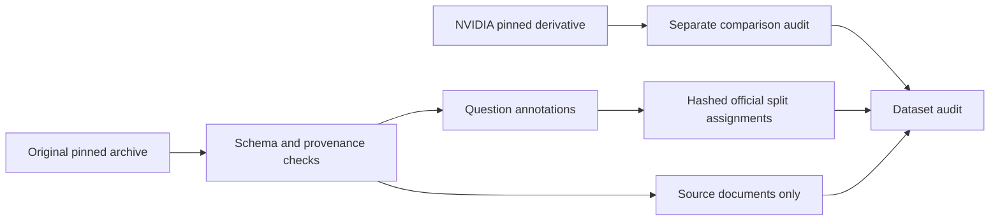

# Model Adaptation Lab

**When are prompting and retrieval sufficient for technical support QA, and when is LoRA worth its cost?**

This research framework will compare Qwen2.5-1.5B-Instruct across zero-shot, few-shot,
RAG, LoRA, and LoRA + RAG under a shared evaluation protocol. It is not a chatbot.

**Status: Phase 1 implemented and audited against real TechQA data.** No model has
been trained or evaluated. Quality, latency, memory, and cost results remain pending.

## What the audit found

- Official training/development: **600 / 310 questions**, **610 answerable** overall.
- **23 exact normalized question overlaps** cross those splits.
- **11 development reference/span mismatches**, including two empty reference answers.
- **28,482 source documents** cover all annotated gold documents.
- NVIDIA's `train` file contains **all 910 train + development records**; it is inspection-only.
- Archive terms say **CDLA-Permissive-1.0**, while the hub card says Apache-2.0.
- No final test set has been designated. Experimental use is blocked pending a written
  overlap/annotation/test protocol; original data have not been silently corrected.

See the [generated audit](reports/dataset_audit.md), [full findings](reports/dataset_audit.json),
and [source review and methodology](reports/source_review.md).

## Reproduce Phase 1

Python 3.12 and [uv](https://docs.astral.sh/uv/) are recommended. Run from the repository root:

```bash
uv sync --locked
uv run model-lab data download   # ~2.96 GB; streams extraction of selected files
uv run model-lab data audit
uv run model-lab data prepare
uv run model-lab data verify
uv run pytest -q
uv run ruff check .
uv run ruff format --check .
uv run mypy
```

Allow about 4 GB of disk space for the archive, extracted subset, and processed data.
No GPU, model weights, API keys, or paid services are needed. CI uses synthetic fixtures only
and never downloads datasets. The lockfile pins the Phase 1 environment.

`data audit` saves a limitations report and exits 2 when sources are missing. `prepare`
preserves official assignments and creates an immutable manifest lock; a changed input
requires a new versioned output directory. `verify` checks integrity, **not readiness**.
`train`, `evaluate`, and `benchmark` are intentionally not implemented yet.

## Data boundaries



Raw data and processed text are ignored by Git. Committed manifests contain IDs and hashes,
not questions or answers. No annotation-derived NVIDIA context is exported as a corpus.
Future RAG may use held-out source documents under an open-book protocol; it must not use
held-out annotations or per-question candidate lists to select retrieval evidence.

**Next:** resolve the documented data protocol, then implement Phase 2's shared base/few-shot
inference interface with traceable token counts, latency, and validation-only prompt selection.
See [development plan](reports/implementation_plan.md) for the remaining phases.
