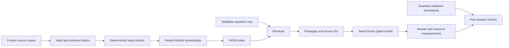

# Phase 3 — source-only retrieval and RAG

Phase 3 is implemented and locally verified. A real MiniLM/FAISS index and a real Qwen
validation smoke completed. These are execution checks, not evidence that RAG improves
technical-support answer quality. No final-holdout annotations were opened or modified.
LoRA training, MLflow tracking, the five-way benchmark, and ablations remain pending.

## Retrieval design and provenance

The unchanged `techqa-internal-v1` protocol permits open-book access to source documents.
The loader checks frozen corpus and protocol hashes and accepts only original technote
fields. It never indexes QA annotations, NVIDIA contexts, or question-specific candidate
lists. Retrieval accepts a question string only; evaluation reads gold annotations afterward.

The complete frozen subset contains **28,482 documents**, not the full 801,998-document
source collection. Its upstream selection includes annotated gold sources, which limits
external validity. Duplicate source documents remain present; top-k counts chunks and
can return several chunks from the same document.

`configs/retrieval.yaml` fixes the representation and prompt:

- `sentence-transformers/all-MiniLM-L6-v2`, model/tokenizer revision
  `1110a243fdf4706b3f48f1d95db1a4f5529b4d41`, Apache-2.0.
- Body-only 224-wordpiece windows, 32-wordpiece overlap, exact character offsets,
  stable chunk IDs and source-document IDs. Titles accompany retrieved passages in the prompt.
- Attention-mask mean pooling, L2 normalization, 384-dimensional float32 embeddings.
- Exact cosine search through normalized vectors and CPU FAISS `IndexFlatIP`, one thread.
  Boundary ties are expanded and sorted by score then chunk ID.
- Top five chunks; questions exceeding the 256-token embedding limit fail explicitly.
  Model input overflow also fails rather than silently dropping evidence.
- `evidence-only-v1` instructs the model to use supplied passages, treat them as untrusted
  reference text, cite exact document IDs, and abstain when evidence is insufficient.

The representation follows the [MiniLM model card](https://huggingface.co/sentence-transformers/all-MiniLM-L6-v2).
The index uses the standard [FAISS flat-index API](https://github.com/facebookresearch/faiss/wiki/Getting-started).
Dataset licensing ambiguity from Phase 1 remains documented; the embedding license does
not change the source-document terms.

## Actual execution

Artifacts are preserved locally in `outputs/retrieval-minilm-v3` and
`outputs/phase3-smoke-mps-fp32`. The committed [machine-readable summary](phase3_smoke.json)
contains aggregate metrics, per-question diagnostics without question/answer text, revisions,
and artifact hashes. Full local artifacts include configs, code snapshots, environment,
retrieved passages, per-question answers, and timings. Outputs and model weights are Git-ignored.

The full index contains **154,630 chunks** and passed `retrieval verify`. Build wall time was
**493.70 seconds**, measured after corpus loading and output-directory creation, including
model setup and index serialization. Host: Apple M3 Pro, 36 GiB unified RAM; embeddings used
MPS float32, batch 64. Packages: PyTorch 2.14.1, Transformers 4.57.6, FAISS CPU 1.15.1,
NumPy 2.5.4, Python 3.12.12. CUDA execution has not been verified on this host.

The smoke used the same two guarded validation records (`DEV_Q161`, `DEV_Q222`) across
base, few-shot, and RAG. Qwen2.5-1.5B-Instruct and tokenizer revision:
`989aa7980e4cf806f80c7fef2b1adb7bc71aa306`. All used MPS float32, greedy generation,
seed 42, and the same 64-output-token smoke cap. Strategy order was base, prompt, RAG;
timing is not randomized or repeated. No settings were selected for favorable results.

| Strategy | Completed | Total input / output tokens | E2E p50 / p95 (ms) |
|---|---:|---:|---:|
| Base | 2/2 | 264 / 24 | 884.82 / 886.28 |
| Few-shot | 2/2 | 1,104 / 56 | 2,371.63 / 3,469.25 |
| RAG | 2/2 | 3,925 / 76 | 4,917.51 / 6,471.33 |

Two observations are insufficient for meaningful latency percentiles or quality comparisons.
Generation warmup is recorded separately; retrieval has no warmup, so the first query includes
cold-query overhead. RAG retrieval averaged **263.49 ms** (361.71 and 165.26 ms), including
query encoding, FAISS process communication/search, and result formatting. Generation took
6,277.46 and 3,021.29 ms. Index/encoder startup took 2,867.67 ms separately from query latency.
CUDA VRAM, training GPU-hours, and monetary inference cost are unavailable, not zero.

For the one answerable record, annotated-document recall@5 was **1/1**, while complete
annotated-span recall@5 was **0/1**. Retrieving the correct document did not guarantee retrieval
of its complete answer span. The answer reached the 64-token limit and emitted no citation;
this is retained as `finish_reason=length`, not treated as a fully completed answer. RAG
abstained on the annotation-unanswerable record. Neither observation establishes correctness.

Precision and relevance remain null because the annotations do not exhaustively judge every
retrieved passage. The gold-chunk fraction is labeled a proxy, not precision. Citation-ID
membership is not factual support; here it is null because no citation was emitted. Semantic
correctness, retrieved/reference evidence support, and unsupported-claim rates remain
unavailable pending the common rubric and human review in Phase 5.

## Failures retained and resolved

Two earlier full-index attempts (`retrieval-minilm-v1` and `retrieval-minilm-v2`) aborted with
exit 134 when PyTorch and FAISS loaded conflicting macOS OpenMP runtimes. Import ordering
alone did not solve the conflict. Their incomplete artifacts remain preserved and are rejected
by verification. Native aborts bypass Python cleanup; their last metadata status is `building`.

FAISS now builds and searches in an isolated CPU process that never imports PyTorch.
The successful v3 build and smoke verify this path. No unsafe duplicate-runtime override is
used. Python-level failures persist failure metadata; index directories cannot be overwritten.

## Verification and next step

Local checks passed: **82 pytest tests**, Ruff formatting/lint, strict mypy (25 source files),
and `git diff --check`. Tests ran in a CPU environment without PyTorch or downloaded models,
using exclusively synthetic fixtures and actual FAISS with synthetic normalized vectors.
They cover corpus integrity, chunks/offsets, stable IDs/ties, index round trips and corruption,
representation mismatches, smoke-index restrictions, failure persistence, span/document recall,
null metrics, strategy conformance, query-only retrieval, and common evaluator persistence.
Frozen manifests, protocol config, and the historical JSON audit remained unchanged.
GitHub Actions is configured; a hosted run has not been observed.

Next: Phase 4, implementing assistant-answer loss masks, validation-selected PEFT checkpoints,
MLflow tracking, and the same adapter for LoRA and LoRA + RAG. Actual CUDA training needs a
suitable machine. Keep primary training format fixed and document evidence-prompt mismatch;
leave the internal final holdout sealed until the Phase 5 release procedure is implemented.
