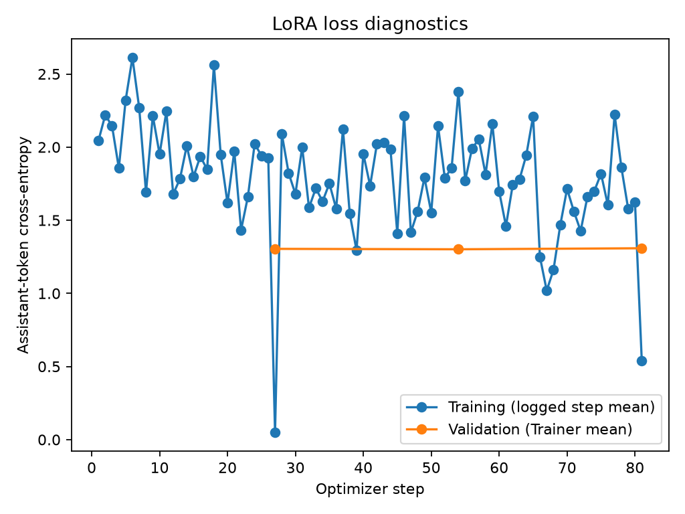

# Phase 4 — LoRA fitting and adapter reuse

Status: real three-epoch rank-8 training completed on Apple M3 Pro MPS. No final-benchmark
or answer-quality conclusion is claimed.
The sequence of remaining research milestones is recorded in [milestones.md](milestones.md).

## Controlled training design

`configs/training.yaml` uses rank 8, alpha 16, dropout 0.05, learning rate 0.0002, three
maximum epochs, batch size 2 and eight accumulation steps (nominal effective batch size 16;
the final group in an epoch can be smaller). Maximum sequence length is 1,024. Seed is 42.
Auto targets resolve explicitly to Qwen attention q/k/v/o and MLP gate/up/down projections.
Only LoRA weights are trainable; base weights remain frozen and adapters are never merged.

Training and validation use `load_annotations` with their required roles. The final holdout
stays sealed. Training uses the baseline system prompt and question with a reference answer,
or the fixed abstention marker for annotation-unanswerable records. No documents, candidate
lists, validation answers, or held-out annotations enter model fitting. Validation answers
are used solely to measure checkpoint-selection loss.

The exact chat template must preserve the generation-prefix token boundary. Only tokens
following that boundary, including assistant end-of-turn tokens, receive loss. Prompt and
padding labels are -100. Padding is right-sided, with an attention mask. Whole over-length
records are excluded and their IDs/counts recorded; neither questions nor reference answers
are silently truncated. All 417 training and 286 validation records fit the limit; zero records were excluded.

The initial implementation uses Transformers Trainer, PEFT, Datasets, and Accelerate.
TRL is unnecessary for this explicit collator and standard supervised Trainer path. Weights
and optimizer use float32, AdamW, a linear scheduler, no warmup, gradient norm clipping at 1,
and non-reentrant gradient checkpointing. Quantization is explicitly rejected in this first
implementation rather than silently ignored. CUDA and explicitly selected MPS/CPU devices
are supported in code; actual execution support is stated separately below.

Checkpoint selection minimizes validation loss measured at each epoch. Early stopping
patience is two evaluations. The initial pre-training validation loss is retained as a
reference, not a competing untrained adapter checkpoint. Two checkpoints are retained under
Trainer's best/latest policy; the selected adapter is exported separately. Epoch metrics
remain available even when a checkpoint is pruned.

Loss curves describe Trainer's supervised cross-entropy and logged optimizer-step loss;
validation loss is Trainer's sample-aggregated batch loss with evaluation batch size 1.
These are training diagnostics, not a validated correctness or groundedness score.

## Provenance, tracking and reproducibility

Each new output directory preserves training config, effective Trainer arguments, dataset
record hashes, the frozen protocol hash, exact model/tokenizer revisions, chat-template hash,
resolved LoRA targets, parameter counts, environment/package versions, and a code snapshot.
MLflow uses a local SQLite database and records loss history, checkpoint-selection metrics,
resource metrics, adapter artifacts and run metadata. Model weights and tracking files remain
Git-ignored. No external tracking service or paid resource is created.

Native MPS/CUDA timings differ; device and dtype are explicit. CUDA allocated/reserved peaks
are process measurements, while MPS/CPU fields are null. Wall time includes setup and
validation as well as fitting; CUDA hours describe that allocated interval on one device,
not accelerator-active utilization. Pricing and inference cost are not inferred from it.
Failed and interrupted runs retain their metadata. Existing output directories cannot be
reused. Resume-from-interruption and quantized training remain future capabilities.

Adapter loading checks completion, base/tokenizer revisions, protocol hash, and artifact
hashes; smoke adapters are rejected for normal evaluation. Base and adapted strategies run
in separate evaluator invocations to avoid accidental adapter contamination of the baseline.
LoRA + RAG uses the identical adapter and retrieval settings. Its evidence-conditioned prompt
is a format mismatch with question-only training; that is a limitation of this controlled
comparison, not a reason to train a different adapter silently.

## Reproduction

```bash
uv sync --locked --extra training --extra retrieval
uv run --extra training model-lab train --config configs/training.yaml \
  --device cuda --output-dir outputs/lora-r8-full
uv run --extra training --extra retrieval model-lab evaluate --strategy adapted \
  --adapter-dir outputs/lora-r8-full --index-dir outputs/my-index \
  --device cuda --dtype float32 --output-dir outputs/adapted-validation
```

Select `--device mps` explicitly on supported Apple hardware. `--smoke` performs two real
optimizer steps on four records per split and marks its artifacts as smoke-only. The
`--fraction` option accepts deterministic nested 0.25/0.5/1.0 subsets; those are infrastructure
for later predeclared ablations, not ablation results. MLflow records can be inspected with
`mlflow ui --backend-store-uri sqlite:///outputs/mlflow.db` from the repository root.

Implementation references: [PEFT LoRA](https://huggingface.co/docs/peft/en/package_reference/lora),
[Transformers Trainer](https://huggingface.co/docs/transformers/main_classes/trainer), and
[MLflow tracking API](https://mlflow.org/docs/latest/ml/tracking/tracking-api/).

## Measured full-training results

The run at `outputs/lora-r8-full-mps-v1` completed all three epochs and 81 optimizer steps
on Apple M3 Pro with 36 GiB unified memory, MPS float32. **9,232,384 parameters** were
trainable out of 1,552,946,688 including adapters. The selected adapter is checkpoint 54,
from epoch two; the third-epoch loss increased slightly and was not selected.

| Checkpoint | Optimizer step | Validation loss | Selection |
|---|---:|---:|---|
| Before training | 0 | 1.633623 | Diagnostic baseline |
| Epoch 1 | 27 | 1.304271 | Superseded |
| Epoch 2 | 54 | **1.301424** | **Exported adapter** |
| Epoch 3 | 81 | 1.308341 | Not selected |



The plot shows optimizer-step training losses and epoch validation losses. The pre-training
baseline is in the table and MLflow, rather than the Trainer history plotted here. Training
step losses vary with example difficulty, dropout, and the smaller final accumulation group;
they are not an independently evaluated training-set curve.

Total recorded wall time was **1,789.80 seconds (29.83 minutes)**. Trainer's fitting interval,
including its epoch validation/checkpoint work, was **1,701.81 seconds**. This is about 0.497
hours of MPS run wall time, not measured accelerator-active utilization or billable CUDA
GPU-hours. CUDA memory and GPU-hour fields remain null; no monetary cost is invented.

MLflow run: `8d6352dfc97245fb9c8d2cafa6f8221d`, status **FINISHED**, in
`outputs/mlflow.db`. Local MLflow artifacts include the adapter, code/config snapshot,
loss history, plot and complete training metadata. The exported adapter weights have SHA-256
`7d92f73e3c3a23ce5e7643a85509ed081efea7e1201387489345e99e91a9c994`.
The [committed training summary](phase4_training.json) contains exact metrics, settings,
package versions and artifact hashes, without training question/answer text or weights.

A separate two-step real MPS smoke preceded this run (MLflow
`93f49fbee70c4643b1a23707b732a758`). Its four-record validation loss moved from 1.740039
to 1.568625. That smoke established execution only and was not used as the primary adapter.

The reduction in validation cross-entropy supports that fitting optimized the supervised
objective. It does **not** establish improved answer correctness, groundedness, calibration,
or generalization. Those require milestone two's validated development evaluator and the
later frozen comparison. No final-holdout questions or answers were accessed.

## Adapter reload and validation smoke

The selected exported weights match checkpoint 54 byte-for-byte. The verified adapter ran
through both `lora` and `lora-rag` strategies on the same two validation IDs used in earlier
smokes. Results are in `outputs/phase4-adapted-smoke-mps-v1`; the
[committed smoke summary](phase4_smoke.json) preserves measured aggregates and provenance.
Both strategies used MPS float32, greedy generation and the same 64-token smoke cap.
LoRA + RAG used the unchanged full frozen MiniLM index and top-five chunk retrieval.

| Strategy | Execution success | Total input / output tokens | E2E p50 / p95 (ms) |
|---|---:|---:|---:|
| LoRA | 2/2 | 264 / 76 | 3,339.06 / 5,396.37 |
| LoRA + RAG | 2/2 | 3,925 / 45 | 4,114.48 / 4,848.90 |

These two-question percentiles are execution diagnostics, not robust performance estimates.
LoRA unnecessarily abstained on `DEV_Q161` and attempted an answer on annotation-unanswerable
`DEV_Q222`, reaching its output-token cap. LoRA + RAG answered `DEV_Q161` and abstained on
`DEV_Q222`. Neither response emitted a citation. No semantic correctness or claim-support
judgment is inferred from these behaviors. Retrieval again found the annotated document but
not the complete annotated span for the answerable record. The observations underline why
validated answer-quality evaluation is the next milestone.

## Verification and remaining work

CPU-only foundation checks: **93 passed, one optional integration test skipped** without
PyTorch. The optional integration test also passed separately with installed PyTorch/PEFT:
a tiny randomly initialized Qwen on synthetic tokens verifies manual loss equivalence,
frozen base weights, actual adapter updates, and identical logits after adapter reload.
The complete suite with training dependencies also passed: **94 tests**, with one expected
PEFT warning about the synthetic model having no pretrained config path.
Ruff lint/format, strict mypy, and Git whitespace checks passed. The configured hosted CI
has not been observed. Frozen manifests, protocol v1 and historical audit remain unchanged.

All five strategy implementations are now available, but the frozen five-way benchmark has
not run. MPS float32 training and inference have real execution evidence. CUDA, quantization,
and interruption resume have not been verified or implemented as applicable. No resource
purchase or cloud host is needed for the completed local run.

Next: milestone two—build and validate the development quality evaluator, including a frozen
rubric, semantic/reference checks, retrieved-versus-reference evidence support, and stratified
human review. Then predeclare the final analysis and ablations before releasing the internal
holdout. Portfolio publication remains pending those results and an evidence-based conclusion.
